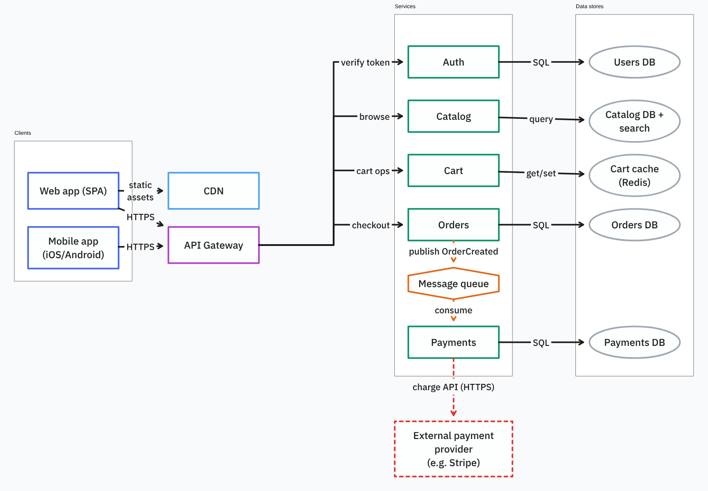

# tldraw-mcp

An MCP server that lets Claude Code draw on tldraw boards. Claude builds the board as a `.tldr` file on your disk. You import that file into tldraw.com, where it becomes a normal board in your account.



Claude Code drew this board through the server. The source is `examples/shop-architecture.tldr`.

## What it does

- Adds every tldraw shape type: the 20 outline shapes (rectangle, ellipse, diamond, cloud, star and the rest), text, sticky notes, frames, lines, freehand strokes, highlighter strokes, images, videos, embeds and link bookmarks.
- Sets tldraw's styles on them: color, fill, dash, size, font, opacity, rotation, lock and flip.
- Takes labels as Markdown. Bold, italic, underline, strikethrough, highlight, inline code, links, headings and nested lists all convert to tldraw rich text.
- Connects shapes with arc or elbow arrows. An arrow binds to a shape at an anchor point, carries a label and takes any of tldraw's arrowheads. Move a shape on tldraw.com and its arrows follow.
- Organizes a board with pages, frames and groups, changes stacking order, duplicates shapes, and runs tldraw's arrange actions (align, distribute, stack, stretch, flip, pack, grid).
- Renders a page with tldraw itself in a headless Chrome or Edge and returns the image to Claude, with warnings for overlapping shapes and for shapes that a frame clips.
- Exports a page or selected shapes as PNG, SVG, JPEG or WebP.
- Reads boards downloaded from tldraw.com, so Claude can change a board you edited by hand.

Every save goes through the validators in `@tldraw/tlschema`, tldraw's own schema package. If any record is invalid, the server writes nothing.

## Requirements

- Node.js 20 or newer.
- Claude Code. The server speaks MCP over stdio, so other clients can run it, but the steps below assume Claude Code.
- Google Chrome or Microsoft Edge, for previews and image export only. Drawing works without a browser.

## Install

```
git clone https://github.com/astralmaster/tldraw-mcp.git
cd tldraw-mcp
npm install
```

`npm install` also builds the preview renderer into `viewer/dist`.

Register the server with Claude Code. Use the full path to your clone:

```
claude mcp add --scope user tldraw -- node /full/path/to/tldraw-mcp/src/index.js
```

On Windows, write the path with forward slashes, for example `C:/tools/tldraw-mcp/src/index.js`.

Then run `claude mcp list`. It should report `tldraw` as connected. Restart any Claude Code session that was already open.

## Usage

Describe the drawing in Claude Code:

> Draw an architecture diagram of this repo on a tldraw board called "architecture". Group frontend and backend into frames, then preview it and fix any problems.

> Make a tldraw flowchart of our checkout: cart, shipping, payment, a "payment ok?" decision, then confirmation, or back to payment with an error.

> On the architecture board, add a page called "Data flow" that shows how an order is processed.

> Add the logo in ./assets/logo.png to the top left of the checkout board, and a sticky note saying "review with design".

> Export the architecture board as SVG.

The server saves a board given by name as `<name>.tldr` in a `tldraw-boards` folder in your home folder. You can also give a path, such as `docs/diagrams/flow.tldr`. The server resolves a relative path against the folder Claude Code was started in.

## Opening a board on tldraw.com

If you are signed in, drag the `.tldr` file onto the left sidebar, or click your name at the bottom of the sidebar and choose "Import file". The file becomes a board in your account, and tldraw.com uploads any images and videos embedded in it to your storage.

If you are signed out, drag the file onto the canvas. That replaces whatever is on the canvas.

To change a board after you have edited it on tldraw.com:

1. On tldraw.com, choose Menu > File > Download file.
2. Save the download into `tldraw-boards`, over the old file.
3. Ask Claude for the change. Claude reads the board before editing it.
4. Import the file again. tldraw.com adds it as a new board, so delete the old one if you no longer want it.

## Tools

| Tool | What it does |
| --- | --- |
| `create_board` | Create a new, empty board |
| `list_boards` | List the boards in the boards folder, newest first |
| `read_board` | List everything on a page: positions, sizes, labels as Markdown, styles, frames, groups and arrows |
| `add_shapes` | Add shapes of any kind |
| `connect` | Add arrows between shapes or points |
| `update_shapes` | Move, resize, rotate, relabel or restyle shapes, change an outline, crop or replace media, re-attach arrows, and move shapes between frames, groups and pages |
| `delete_shapes` | Delete shapes. Deleting a frame or group deletes its contents |
| `duplicate_shapes` | Copy shapes with the arrows between them, optionally to another page |
| `group_shapes`, `ungroup_shapes` | Group and ungroup |
| `reorder_shapes` | Bring to front, send to back, or move one step |
| `arrange_shapes` | Align, distribute, stack, stretch, flip, pack or lay out in a grid |
| `add_page`, `update_page`, `delete_page` | Add, rename, reorder and delete pages |
| `preview_board` | Render a page with tldraw and return the image and layout warnings |
| `export_board` | Save a page or selected shapes as PNG, SVG, JPEG or WebP |

A call that changes a board saves all of its items or none. If one item in a batch is invalid, the server writes nothing, and the error names the item and says how to fix it.

## Settings

Pass any of these with `-e NAME=value` when you register the server:

```
claude mcp add --scope user -e TLDRAW_BOARDS_DIR=/full/path/to/boards tldraw -- node /full/path/to/tldraw-mcp/src/index.js
```

| Variable | Default | Meaning |
| --- | --- | --- |
| `TLDRAW_BOARDS_DIR` | `tldraw-boards` in your home folder | Folder for boards given by name |
| `CHROME_PATH` | found automatically | Browser for previews and export, when the server cannot find Chrome or Edge |
| `TLDRAW_MAX_MEDIA_MB` | `10` | Largest local image or video file the server embeds |
| `TLDRAW_PREVIEW_MAX_PX` | `1600` | Longest side of the preview image Claude receives |

## Updating tldraw

The server pins the tldraw packages to one exact version. When tldraw.com moves to a newer file format, Claude reports that a board was "saved by a newer version of tldraw". Run this in the tldraw-mcp folder:

```
npm run update-tldraw
```

The script installs the newest release of all four tldraw packages, rebuilds the preview renderer and runs the tests.

## Limits

The server has no live connection to tldraw.com. It edits files, and each import creates a new board. tldraw's own [MCP app](https://tldraw.dev/blog/tldraw-mcp-app) is a different project that shows a canvas inside the chat client.

`preview_board` and `export_board` change the board file, because they store tldraw's measured label sizes in it. Copy a board first if the original must stay untouched.

Other things to know:

- The server embeds local images and videos in the `.tldr` file, up to 10 MB each by default. It stores web URLs as links.
- YouTube, Figma and other embeds play on tldraw.com but appear as blank cards in exported images. Bookmarks show their title.
- Comments on tldraw.com boards are not part of `.tldr` files.
- Previews load tldraw's fonts from the local build, so they work offline.

## Troubleshooting

| Problem | Fix |
| --- | --- |
| `claude mcp list` shows the server failed | Run `node /full/path/to/tldraw-mcp/src/index.js` yourself. A working server waits silently until you press Ctrl+C. A broken one prints the error. Check that `npm install` finished. |
| A preview says Chrome or Edge is needed | Install Chrome or Edge, or register with `-e CHROME_PATH=/path/to/browser`. |
| "The preview renderer is not built" | Run `npm run build-viewer` in the tldraw-mcp folder. |
| tldraw.com will not open a file | Run `npm run update-tldraw`, then ask Claude to read and save the board again. |

## Development

```
npm test
CHROME_PATH=/path/to/chrome npm test
```

The first command runs the 13 drawing tests and skips the 3 rendering tests. With `CHROME_PATH` set, all 16 run, and the rendering tests go through real tldraw in the browser. In PowerShell, set the variable first with `$env:CHROME_PATH = 'C:\path\to\chrome.exe'`.

The tests start the server over stdio the way Claude Code does, and they validate every saved file with tldraw's schema.

`src/index.js` is the server, with one handler per tool, and `src/tools.js` holds the tool schemas. `src/board.js` reads, edits and writes `.tldr` files. It gets help from `richtext.js` (Markdown to tldraw rich text and back), `geometry.js` (rotation math) and `assets.js` (media and link previews). `src/preview.js` drives the headless browser, which loads the page built from `viewer/viewer.jsx`.

## License

The code in this repository is MIT licensed.

The tldraw SDK is not. `npm install` downloads it from npm under the [tldraw license](https://tldraw.dev/community/license), which permits development use by default and requires a license key in production. This server loads the SDK in a headless browser on `127.0.0.1`, only to render previews and exports. The SDK treats that as a development environment and runs without a key. Read the tldraw license to decide whether your own use needs a key.
